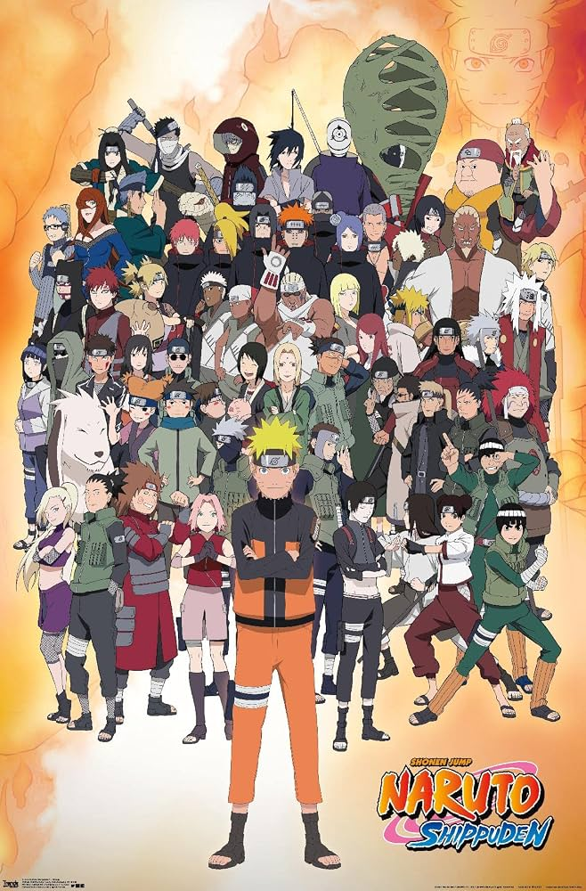

### 火影忍者

《**火影忍者**》（Naruto）是一部由岸本齐史创作的少年漫画及动画，主要讲述了**漩涡鸣人**从一个被村民排斥的孤儿，成长为守护忍界的英雄，并最终成为火影的故事。

---

# 故事背景

故事发生在一个由多个忍者村组成的世界。

五大国分别拥有五大忍村：

- 木叶隐村（主角所在）
- 砂隐村
- 雾隐村
- 云隐村
- 岩隐村

忍者执行各种任务，同时各国之间也存在竞争与战争。

---

# 第一部（少年篇）

## 1. 鸣人的成长

主角**漩涡鸣人**体内封印着强大的九尾妖狐，因此从小受到村民排斥。

他的梦想只有一个：

> 成为火影，让所有人认可自己。

他从忍者学校毕业后，与：

- 宇智波佐助
- 春野樱

组成**第七班**，老师是旗木卡卡西。

---

## 2. 波之国篇

第七班首次执行高级任务。

他们遇见：

- 桃地再不斩
- 白

这是鸣人第一次真正面对死亡，也开始理解：

> 忍者不仅仅是战斗，还有信念。

---

## 3. 中忍考试

来自各国的年轻忍者参加考试。

这里出现许多重要角色：

- 我爱罗
- 日向宁次
- 李洛克
- 奈良鹿丸

同时，大蛇丸袭击木叶。

---

## 4. 木叶崩溃

大蛇丸发动战争。

第三代火影猿飞日斩牺牲。

佐助开始越来越执着于力量。

---

## 5. 佐助叛逃

佐助为了获得打败哥哥鼬的力量，投靠大蛇丸。

鸣人与佐助在终结之谷展开激战。

最终：

- 鸣人战败。
- 佐助离开木叶。

第一部结束。

---

# 第二部：火影忍者 疾风传

时间来到两年半后。

鸣人与自来也修行归来。

整个故事进入真正高潮。

---

## 1. 晓组织登场

神秘组织"晓"开始捕捉尾兽。

成员包括：

- 宇智波鼬
- 干柿鬼鲛
- 迪达拉
- 蝎
- 飞段
- 角都
- 小南
- 佩恩
- 带土（幕后）

他们真正目标是收集九只尾兽。

---

## 2. 我爱罗被抓

一尾守鹤被抽离。

我爱罗死亡。

后来被千代婆婆用生命救活。

---

## 3. 佐助复仇

佐助先后击败：

- 大蛇丸
- 宇智波鼬

后来得知：

> 鼬一直都是为了保护弟弟。

木叶高层曾命令鼬灭掉宇智波一族，以阻止政变。

佐助因此憎恨木叶。

---

## 4. 佩恩袭击木叶

佩恩毁灭木叶村。

鸣人学会仙人模式。

双方大战后：

鸣人没有杀死长门（佩恩本体），而是用自己的理念说服了他。

长门最终牺牲自己，复活了大量木叶村民。

这是全剧最经典的剧情之一。

---

## 5. 第四次忍界大战

幕后黑手逐渐浮出水面。

真正计划包括：

- 带土发动战争
- 复活宇智波斑
- 收集全部尾兽
- 实现"无限月读"

五大忍村第一次联合组成忍者联军。

---

## 6. 六道仙人与辉夜

鸣人与佐助获得六道仙人的力量。

随后真正幕后：

**大筒木辉夜**复活。

她是查克拉始祖。

鸣人与佐助、小樱、卡卡西联手将辉夜封印。

---

## 7. 最终决战

大战结束后，

鸣人与佐助再次来到终结之谷。

两人展开最终决战。

最终：

- 双双失去一只手臂。
- 佐助承认鸣人。
- 两人成为真正的朋友。

忍界恢复和平。

---

# 结局

多年以后：

- 鸣人与日向雏田结婚。
- 佐助与春野樱结婚。
- 鹿丸等人各自成家。

最终：

**鸣人实现梦想，成为第七代火影。**

故事圆满结束。

---

# 主要人物

| 人物    | 简介                   |
|-------|----------------------|
| 漩涡鸣人  | 主角，第七代火影，九尾人柱力。      |
| 宇智波佐助 | 鸣人的挚友兼宿敌，后成为守护木叶的忍者。 |
| 春野樱   | 第七班成员，优秀的医疗忍者。       |
| 旗木卡卡西 | 第七班导师，后成为第六代火影。      |
| 日向雏田  | 鸣人的妻子，日向一族成员。        |
| 宇智波鼬  | 佐助的哥哥，为保护木叶背负骂名。     |
| 自来也   | 鸣人的老师，被称为"好色仙人"。     |
| 大蛇丸   | 三忍之一，长期追求永生与禁术。      |
| 我爱罗   | 砂隐村风影，与鸣人成为好友。       |

---

# 故事主线时间轴

1. 鸣人成为下忍
2. 波之国任务
3. 中忍考试
4. 木叶崩溃计划
5. 佐助叛逃
6. 鸣人修行两年半
7. 晓组织开始捕捉尾兽
8. 我爱罗获救
9. 阿斯玛战死
10. 自来也调查佩恩并牺牲
11. 佐助击败鼬
12. 佩恩袭击木叶
13. 五影会谈
14. 第四次忍界大战
15. 宇智波斑复活
16. 无限月读发动
17. 大筒木辉夜复活
18. 鸣人与佐助封印辉夜
19. 终结之谷最终决战
20. 鸣人成为第七代火影

---

# 故事核心主题

《火影忍者》不仅讲述忍者战斗，更围绕几个贯穿全剧的主题展开：

- **友情**：鸣人与佐助从对立走向互相理解。
- **努力**：鸣人从"吊车尾"成长为最强忍者之一。
- **羁绊**：伙伴、师徒、家人与村子的联系推动着每个人的成长。
- **仇恨与宽恕**：许多角色背负仇恨，而鸣人试图打破冤冤相报的循环。
- **传承**：火之意志一代代延续，年轻一代继承前辈的信念。

---

# 一句话总结

**《火影忍者》讲述了鸣人与伙伴们不断成长、守护木叶、化解仇恨，并最终结束忍界大战，实现梦想成为第七代火影的热血传奇。**