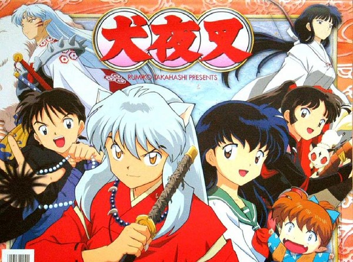

### 犬夜叉

《犬夜叉》是日本漫画家高桥留美子创作的奇幻冒险作品，讲述了现代少女日暮戈薇穿越到日本战国时代，与半妖犬夜叉相遇，并与伙伴们一起寻找四魂之玉碎片、对抗妖怪奈落的故事。

作品融合了日本妖怪文化、战国时代背景、冒险战斗与爱情故事。主线围绕四魂之玉展开，同时描写犬夜叉对自身身份的接纳、戈薇与桔梗之间复杂的情感，以及众人如何面对过去、仇恨与命运。

## 犬夜叉与桔梗的悲剧

故事发生在日本战国时代。犬夜叉是一名半妖，父亲是犬妖，母亲是人类。由于半妖的身份，他长期受到人类与妖怪的排斥，因此渴望获得更强大的力量，摆脱自身的困境。

当时，巫女桔梗负责守护拥有神秘力量的四魂之玉。四魂之玉能够增强妖怪的力量，也会放大持有者的欲望，因此成为各方争夺的目标。

犬夜叉与桔梗在相处中逐渐相爱。犬夜叉希望借助四魂之玉变成人类，与桔梗一起生活；桔梗也希望放下守护宝物的责任，过上普通人的生活。

然而，一个名为奈落的妖怪破坏了他们的愿望。

奈落由盗贼鬼蜘蛛的欲望与众多妖怪融合而成。他利用犬夜叉与桔梗之间的感情，制造双方背叛彼此的假象。犬夜叉因此被桔梗封印在御神木上，而桔梗也在重伤后离世，并将四魂之玉一同火化。

这场阴谋使两人分离，也成为犬夜叉与奈落之间漫长斗争的起点。

## 戈薇穿越，四魂之玉破碎

数百年后，生活在现代日本的少女日暮戈薇意外被妖怪拖入神社中的食骨之井，穿越到了战国时代。

戈薇发现自己与已经去世的巫女桔梗有着惊人的相似之处，而且拥有特殊的灵力。她意外解开了犬夜叉的封印，让沉睡多年的犬夜叉重新苏醒。

起初，两人互不信任。犬夜叉性格冲动、倔强，戈薇则对战国时代的一切感到陌生。为了限制犬夜叉的鲁莽行为，戈薇利用咒语让他听从自己的指令，“坐下”也成为贯穿作品的经典桥段。

不久后，四魂之玉意外破碎，碎片散落各地。为了避免碎片落入邪恶妖怪手中，戈薇与犬夜叉踏上了寻找碎片的旅程。

这场旅程不仅让他们不断遭遇强敌，也让他们逐渐理解彼此，为后续的冒险建立了基础。

## 伙伴集结，共同寻找碎片

随着冒险展开，犬夜叉与戈薇陆续结识了几位重要伙伴。

- **弥勒：** 一名拥有风穴的法师。由于家族受到奈落的诅咒，他希望消灭奈落，解除自己与后代面临的危险。
- **珊瑚：** 实力出众的除妖师。她的家族遭到奈落算计，弟弟琥珀也被奈落控制，因此她加入队伍，希望复仇并拯救弟弟。
- **七宝：** 年幼的狐狸妖怪，擅长幻术与变化术，为团队带来不少欢乐。
- **杀生丸：** 犬夜叉同父异母的兄长，拥有强大的纯血犬妖力量。起初他追求力量并轻视犬夜叉，后来在与人类女孩铃的相处中逐渐改变。

这些伙伴各自背负着不同的过去，却因为奈落的阴谋与四魂之玉的争夺走到一起。

他们一边寻找碎片，一边阻止妖怪伤害人类，也逐渐发现许多看似独立的事件背后，都隐藏着奈落的操纵。

## 桔梗复活：无法放下的过去

随着剧情发展，桔梗以特殊的方式复活，再次出现在犬夜叉面前。

犬夜叉始终无法忘记过去与桔梗的感情。当他逐渐知道两人当年的分离是奈落制造的阴谋时，既痛苦又愤怒，因为他们原本有机会拥有不同的人生。

然而，复活后的桔梗已经无法回到过去。她仍然憎恨奈落，也无法完全放下对犬夜叉的感情。

与此同时，戈薇逐渐爱上犬夜叉，却不得不面对犬夜叉与桔梗之间深刻的羁绊。

这段关系成为作品的重要情感主线：

- 犬夜叉必须面对过去的遗憾，并逐渐学会珍惜现在。
- 戈薇需要明白，自己不必成为桔梗的替代品，而是可以凭借自身的性格与选择获得犬夜叉的感情。
- 桔梗则必须在复仇、执念与内心的痛苦之间作出选择。

桔梗的悲剧让犬夜叉一行人更加坚定了消灭奈落的决心，也让整部作品的主线从寻找四魂之玉逐渐转向揭开奈落的真相。

## 奈落的阴谋与犬夜叉的成长

奈落是贯穿全剧的主要反派。他擅长操纵人心、制造误会，并通过吸收妖怪不断增强自己的力量。

他不仅造成犬夜叉与桔梗的悲剧，还利用珊瑚与琥珀之间的亲情，控制琥珀并迫使珊瑚陷入痛苦的抉择。

奈落也创造了多个分身。其中，神乐渴望自由，不愿永远受奈落控制；神无则表现得更加冷漠，成为奈落执行计划的工具。这些分身的不同选择，也揭示了奈落自身无法摆脱的控制欲。

面对越来越强大的敌人，犬夜叉不断提升自己的战斗能力。

他使用父亲留下的铁碎牙，逐步掌握风之伤、爆流破等强大招式。但真正的挑战不只是增强力量，还包括控制半妖血统带来的危险。

当犬夜叉陷入极端愤怒时，可能会失去理智，变成只凭本能战斗的妖怪。因此，他必须学会接受自己的身份，控制内心的恐惧与愤怒。

杀生丸也在这一过程中逐渐成长。他从一个只重视力量的妖怪，转变为能够理解生命价值、愿意保护铃的人。犬夜叉与杀生丸虽然道路不同，却都逐渐明白，强大并不意味着必须否定自己的弱点或轻视他人。

## 最终决战：四魂之玉与奈落的执念

随着四魂之玉碎片逐渐汇集，奈落的力量不断增强。他企图利用四魂之玉获得更强大的力量，并试图摆脱自身的弱点。

但奈落始终无法摆脱自己内心的矛盾。

他由鬼蜘蛛对桔梗的欲望而诞生，却又无法坦然面对自己残留的人类情感。他不断追求力量，试图控制一切，却始终被嫉妒、占有欲与执念束缚。

最终，犬夜叉与伙伴们迎来了与奈落的决战。

犬夜叉凭借铁碎牙与不断成长的实力正面迎战，戈薇则运用灵力对抗四魂之玉中的邪恶力量。弥勒、珊瑚、琥珀以及其他伙伴也在战斗中发挥各自的作用。

这场决战不仅是力量的较量，也是所有人面对过去的最后考验。

犬夜叉不再像过去那样只想独自承担一切，而是学会信任伙伴。珊瑚努力守护弟弟，杀生丸继续走自己的道路，而桔梗也逐渐走向属于自己的最终命运。

经过漫长的战斗，奈落最终走向毁灭，四魂之玉的问题也迎来终结。

## 结局：戈薇与犬夜叉重逢

**以下包含《犬夜叉：完结篇》的结局剧透。**

奈落被击败后，戈薇面对四魂之玉带来的最后考验，并作出了自己的选择。四魂之玉最终消失，但戈薇也因此回到了现代世界，食骨之井暂时失去了连接两个时代的力量。

戈薇与犬夜叉被迫分离。

回到现代后，戈薇逐渐恢复日常生活，却始终无法忘记战国时代的伙伴与犬夜叉。犬夜叉同样无法放下戈薇，只能等待再次相见的机会。

三年后，食骨之井重新开启了通往战国时代的道路。戈薇主动选择回到犬夜叉身边，两人终于重逢。

其他角色也逐渐迎来新的生活：

- **弥勒与珊瑚：** 两人最终结为夫妻，建立了自己的家庭。
- **琥珀：** 逐渐走出过去的阴影，继续作为除妖师生活。
- **杀生丸与铃：** 杀生丸继续守护铃，而铃也逐渐成长，拥有选择未来的机会。
- **七宝：** 继续修行，希望成为更强大的狐狸妖怪。
- **桔梗：** 她的故事以悲剧收尾，但最终也从长期的痛苦与执念中获得了解脱。

故事最终以犬夜叉与戈薇重逢作为重要落点。两人经历了过去的悲剧、漫长的冒险与三年的分离，终于能够共同面对未来。

## 作品主题与主线总结

《犬夜叉》的主线可以概括为三个阶段：

1. **寻找四魂之玉：** 戈薇穿越到战国时代，与犬夜叉相遇，四魂之玉破碎后，两人开始寻找散落各地的碎片，并逐渐集结伙伴。
2. **揭开奈落的阴谋：** 犬夜叉与桔梗的过去逐渐揭晓，奈落不断制造阴谋，犬夜叉一行人为了复仇、守护亲人和结束灾难而持续战斗。
3. **打败奈落并迎来新生活：** 随着最终决战结束，四魂之玉消失，众人逐渐放下过去的执念，犬夜叉与戈薇最终重逢。

整部作品最重要的主题，是**接受自己、面对过去、珍惜羁绊，以及主动选择未来**。

犬夜叉从一个因为半妖身份而自卑、孤独的少年，逐渐成长为懂得信任伙伴、愿意保护他人的战士；戈薇从意外穿越的现代少女，成长为能够独立作出选择的人；杀生丸则从只相信力量的妖怪，逐渐理解生命与情感的价值。

而奈落的失败也揭示了作品的核心思想：一个人即使拥有强大的力量，如果始终被欲望、仇恨与执念控制，也无法真正获得自由。

**《犬夜叉》不仅是一场寻找四魂之玉的奇幻冒险，更是一个关于成长、爱情、遗憾与救赎的故事。**
