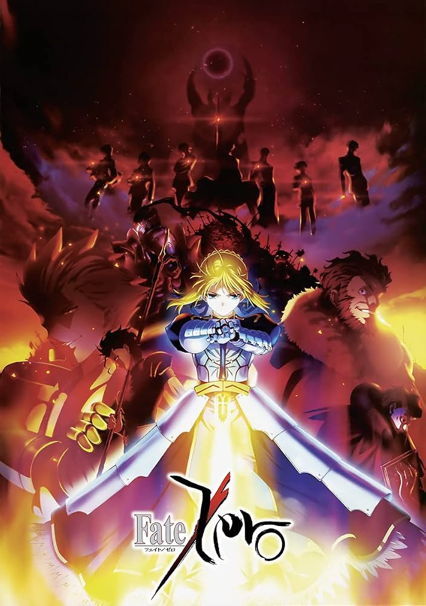

### Fate/Zero

**《Fate/Zero》** 是 Type-Moon 推出的小说，由虚渊玄执笔，奈须蘑菇监修，后来由 ufotable 改编为动画，共两季（25 集）。

故事发生在 **《Fate/stay night》前十年**，讲述第四次圣杯战争的全过程，也是 Fate 系列的重要前传。

---

在日本冬木市，流传着一个名为**圣杯战争（Holy Grail War）**的秘密仪式。

传说中的圣杯能够实现持有者的任何愿望。

为了争夺圣杯，七名被选中的**Master（御主）**，分别召唤七位历史、神话中的英雄作为**Servant（从者）**，展开一场只有最后胜利者才能获得圣杯的残酷战争。

七个职阶分别为：

- Saber（剑士）
- Archer（弓兵）
- Lancer（枪兵）
- Rider（骑兵）
- Caster（魔术师）
- Assassin（暗杀者）
- Berserker（狂战士）

每位 Master 与 Servant 签订契约，共同战斗，直到只剩最后一组。

---

# 第四次圣杯战争

故事开始时，冬木市迎来了第四次圣杯战争。

七组参战者分别登场，每个人都有不同的信念、理想与欲望。

然而，这场战争远比他们想象中更加残酷。

---

# 主要阵营

## Saber 阵营

### Master：卫宫切嗣（Emiya Kiritsugu）

被称为"魔术师杀手"。

为了实现世界和平，他愿意牺牲少数人拯救多数人。

他相信：

> 只要能够拯救更多的人，再残酷的方法都是正确的。

因此，他擅长暗杀、爆破、狙击，而不是传统魔术师之间的正面对决。

---

### Servant：Saber（阿尔托莉雅·潘德拉贡）

即传说中的亚瑟王。

她追求骑士精神，希望通过圣杯重新选择不列颠的王，以改变国家灭亡的命运。

她重视荣耀、公正与信义。

然而，她与切嗣的理念完全不同。

切嗣只追求结果。

Saber 更重视过程与骑士道。

两人的理念冲突贯穿全剧。

---

## Archer 阵营

### Master：远坂时臣

冬木市御三家之一远坂家的家主。

优秀、冷静、典型的传统魔术师。

他的目标就是获得圣杯，抵达"根源"。

---

### Servant：吉尔伽美什（Gilgamesh）

英雄王。

世界上最古老的英雄。

拥有几乎无限数量的宝具。

他认为：

> 世界上的一切宝物都属于自己。

他高傲、自信、蔑视众生。

虽然很少认真战斗，却拥有压倒性的实力。

---

## Rider 阵营

### Master：韦伯·维尔维特（Waver Velvet）

时钟塔的年轻学生。

因为不服导师而偷走圣遗物，参加圣杯战争。

刚开始胆小、自卑，没有经验。

随着战争推进，他逐渐成长。

---

### Servant：伊斯坎达尔（征服王）

历史上的亚历山大大帝。

豪爽、热血、富有魅力。

他认为：

> 王必须站在人民之前，引领他们前进。

他梦想再次征服世界。

也是全剧最受欢迎的角色之一。

---

## Lancer 阵营

### Master：肯尼斯·艾尔梅洛伊

时钟塔讲师。

魔术天才。

自尊心极强。

---

### Servant：迪卢木多·奥迪那

凯尔特神话中的英雄。

忠诚、谦逊。

拥有两把魔枪：

- 破魔红蔷薇
- 必灭黄蔷薇

由于枪的特殊能力，给 Saber 留下无法治愈的伤口。

最终却因为 Master 的命令自尽，成为整部作品中最悲剧的角色之一。

---

## Caster 阵营

### Master：雨生龙之介

普通杀人狂。

因为误打误撞召唤出 Servant。

把圣杯战争当作游戏。

---

### Servant：吉尔·德·雷

法国元帅。

由于对贞德的疯狂执念而堕落。

认为 Saber 就是贞德。

两人不断制造大规模屠杀。

他们召唤出的巨大海魔甚至迫使各方暂时联手。

---

## Berserker 阵营

### Master：间桐雁夜

为了拯救间桐樱，自愿接受间桐家的虫魔术改造。

身体不断被虫侵蚀。

生命逐渐走向终点。

---

### Servant：兰斯洛特

圆桌骑士第一勇士。

因为背叛亚瑟王而陷入疯狂。

成为 Berserker。

他对 Saber 怀有极深的愧疚。

---

## Assassin 阵营

### Master：言峰绮礼

监督者言峰璃正之子。

没有人生目标。

一直感受不到快乐。

直到战争中遇见吉尔伽美什。

---

### Servant：哈桑·萨巴赫

拥有多个分身。

负责侦察、暗杀。

虽然实力一般，但情报能力极强。

---

# 圣杯战争的发展

战争初期，各方互相试探。

Assassin 首先作为诱饵暴露身份，实际上利用分身持续监视其他阵营。

Caster 与龙之介不断制造连环杀人事件，甚至召唤出巨大海魔，造成冬木市严重危机。

面对共同敌人，Saber、Rider、Archer 等人暂时联手，最终成功消灭海魔。

随后，战争进入更加残酷的阶段。

Lancer 被 Master 强迫自尽。

肯尼斯与未婚妻索拉乌双双死亡。

Berserker 的真实身份揭晓，兰斯洛特与 Saber 的宿命对决令人唏嘘。

雁夜因长期遭受虫魔术侵蚀而精神崩溃，最终悲惨死去。

战争逐渐只剩下 Saber、Archer、Rider 三大阵营展开最终决战。

---

# 王者酒宴

《Fate/Zero》中最经典的桥段之一便是**王之酒宴**。

征服王伊斯坎达尔邀请 Saber 与英雄王吉尔伽美什共同饮酒，并讨论"什么是真正的王"。

三位王提出了截然不同的理念：

- **Saber**：王应当牺牲自己，为人民奉献。
- **Rider**：王应引领人民，让人民追随自己的梦想。
- **Archer**：王凌驾于一切之上，人民只是王的财产。

这场辩论不仅展现了三位王者的性格，也深刻体现了全剧关于理想、责任与统治方式的思考。

---

# 最终决战

随着战争进入尾声，Rider 向 Archer 发起最后的冲锋。

尽管伊斯坎达尔施展固有结界**「王之军势（Ionioi Hetairoi）」**，率领昔日追随者共同作战，却依旧无法战胜拥有无数宝具的英雄王。

最终，Rider 战死。

韦伯虽然失去了从者，却获得了真正的成长，也继承了征服王的精神。

另一边，卫宫切嗣逐渐发现圣杯并非真正能够实现愿望的奇迹，而是会按照愿望持有者的认知，以最极端、最残酷的方式实现愿望。

为了避免世界遭到毁灭，他命令 Saber 亲手摧毁圣杯。

圣杯被破坏后，大量黑泥倾泻而出，引发冬木市大火，无数居民因此丧生。

---

# 战争结局

第四次圣杯战争最终以惨烈的代价结束：

- 卫宫切嗣成为最后的胜利者，却失去了妻子爱丽丝菲尔，也彻底失去对理想的信念。
- Saber 被迫摧毁圣杯，带着遗憾返回属于自己的时代。
- 吉尔伽美什因圣杯黑泥获得肉身，继续留在人间。
- 言峰绮礼在圣杯黑泥影响下重获新生，并第一次感受到愉悦，从此彻底堕入黑暗。
- 韦伯幸存下来，后来成为时钟塔著名讲师——**埃尔梅罗二世（Lord El-Melloi II）**。
- 切嗣在冬木大火中救下孤儿卫宫士郎，并将其收养，为《Fate/stay night》的故事埋下伏笔。

---

# 主题思想

《Fate/Zero》并非单纯描写魔术师之间的战斗，而是围绕**理想、信念、人性与王道**展开讨论。

作品通过不同角色的理念冲突，探讨了多个核心命题：

- 理想是否值得为之牺牲一切。
- 正义是否一定能够带来幸福。
- 王者究竟应该统治人民，还是服务人民。
- 当现实与理想发生冲突时，人应该如何选择。

全剧没有绝对的正义与邪恶，每位角色都坚持着自己的信念，也都必须为自己的选择付出代价。

---

# 与《Fate/stay night》的关系

《Fate/Zero》是《Fate/stay night》的前传，时间线相隔十年。

第四次圣杯战争中发生的事件，直接影响了第五次圣杯战争：

- 卫宫士郎成为切嗣的养子。
- 言峰绮礼成为第五次战争的重要人物。
- 吉尔伽美什获得肉身继续活动。
- 远坂家、间桐家等家族的命运也因此改变。

因此，《Fate/Zero》不仅是一部独立作品，也是理解整个 Fate 系列世界观和人物关系的重要基础。