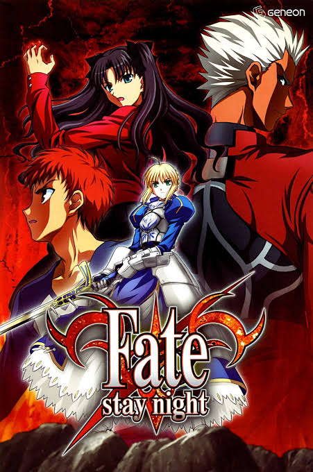

### Fate/stay night

《Fate/stay night》是 TYPE-MOON 创作的经典奇幻作品，讲述了魔术师们为了争夺“圣杯”而展开的残酷战争。圣杯据说能够实现持有者的一切愿望，因此各方势力都为之厮杀。故事的核心围绕着少年 **卫宫士郎** 与英灵 **Saber** 的契约展开。

## 故事背景
在冬木市，每隔数十年就会举行一次“圣杯战争”。七位被称为“御主”的魔术师，召唤出七位来自历史与传说中的英雄灵魂，也就是“英灵”，并让他们互相战斗，直到最后只剩下一组搭档，才能获得圣杯。

这场战争表面上是争夺奇迹之杯，实际上却隐藏着巨大的阴谋与代价。参与者不仅要面对敌人，还要面对自己内心的欲望、信念与抉择。

## 主要剧情
卫宫士郎是一个坚持“拯救所有人”的少年，他因为过去的灾难而立志成为正义的伙伴。在某一天，他意外卷入圣杯战争，并召唤出骑士王 **Saber** 成为自己的从者。

随着战斗不断升级，士郎逐渐认识到圣杯战争的残酷本质，也开始思考自己的理想究竟是否正确。不同阵营的御主与英灵相继登场，每个人都有自己的愿望、执念与悲剧。

在不断的冲突中，士郎必须在“理想”和“现实”之间做出选择，而他与 Saber 的关系，也成为整个故事最重要的情感主线之一。

## 主要角色
### 卫宫士郎
本作男主角，性格温柔而固执，始终想要保护他人。虽然力量并不算最强，但拥有极强的意志。

### Saber
士郎召唤出的英灵，真实身份是亚瑟王。她冷静、强大、沉默寡言，但内心也背负着沉重的过去。

### 远坂凛
优秀的魔术师，兼具实力与傲娇气质，是故事中非常重要的女主角之一。

### 间桐樱
温柔内敛的少女，与士郎关系密切，在不同路线中有着极其重要的戏份。

## 故事主题
《Fate/stay night》并不只是单纯的战斗作品，它更强调以下主题：

- 理想与现实的冲突
- 拯救他人与自我牺牲
- 命运与选择
- 英雄的代价
- 爱与救赎

## 作品特点
- 世界观设定复杂而完整
- 战斗场面热血，魔术体系独特
- 角色塑造非常鲜明
- 不同路线会呈现不同主题与结局

## 总结
《Fate/stay night》是一部融合了奇幻、战斗、宿命与情感的经典作品。它通过圣杯战争这一舞台，讲述了一个关于理想、牺牲与选择的故事。无论是剧情深度还是角色魅力，都让它成为 Fate 系列中最具代表性的作品之一。