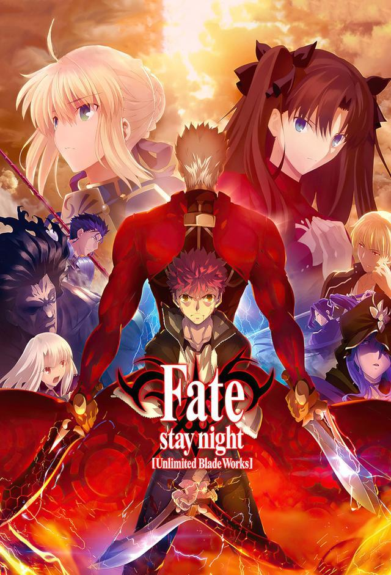

# 已看完动漫
### 火影忍者

### Fate/saty night：UBW

《Fate/stay night: Unlimited Blade Works》（简称 UBW） 是《Fate/stay night》游戏中的第二条主线（Route），也是最受欢迎的一条路线之一。它主要围绕卫宫士郎和远坂凛展开，同时深入探讨士郎的理想——“成为正义的伙伴”。

故事背景
故事发生在第五次圣杯战争。
七位魔术师（Master）召唤七位英灵（Servant）争夺圣杯。
主角卫宫士郎意外卷入战争，与 Saber 结下契约。
在 UBW 线中，士郎与 远坂凛 成为盟友，而不像其他路线那样以 Saber 或间桐樱作为主要女主角。
UBW 的核心剧情
1. 士郎和凛联手
由于共同面对其他 Master，两人决定暂时合作。
凛是优秀的魔术师，而士郎虽然魔术水平很差，却拥有特殊能力。

3. Archer 身份之谜
UBW 最大的谜团就是：
Archer 到底是谁？

随着剧情推进，最终揭晓：
Archer 就是未来的卫宫士郎。

他是在未来坚持"正义伙伴"理想，却最终被世界利用，成为英灵（守护者）的士郎。
由于不断杀人、拯救别人、背负痛苦，他开始憎恨年轻时那个天真的自己。
于是：
Archer 想杀死过去的士郎。

希望借此让自己的存在消失（虽然理论上并不会成功）。

3. 理想之争
UBW 最精彩的部分不是打架，而是：
士郎 vs Archer
实际上就是：
过去的自己 vs 未来的自己

双方争论的是：
"坚持理想有没有意义？"

Archer 认为：
- 正义伙伴只是幻想
- 不可能救所有人
- 最后只会后悔
- 理想终究会毁掉自己
而士郎回答：
即使最后失败，
我也不会否定曾经追求那个梦想。

这是整条 UBW 的主题。

4. Unlimited Blade Works
Archer 和士郎拥有相同的固有结界：
Unlimited Blade Works（无限剑制）

里面是一片布满无数剑的世界。
士郎真正觉醒后，也能够展开 UBW。
这是他魔术的本质：
- 投影（Trace）
- 复制武器
- 无限制造剑
5. 最终决战
真正的大反派并不是 Archer。
Archer 最后选择帮助士郎。
最终士郎、凛等人与敌人展开决战，阻止圣杯带来的灾难。
UBW 的主题
UBW 可以概括成一句话：
理想即使无法实现，也值得坚持。

Archer：
理想会让你后悔。

士郎：
即使如此，我也不会否定它。

因此 UBW 更像是一部关于成长、理想、自我认同的故事，而不仅仅是圣杯战争。
